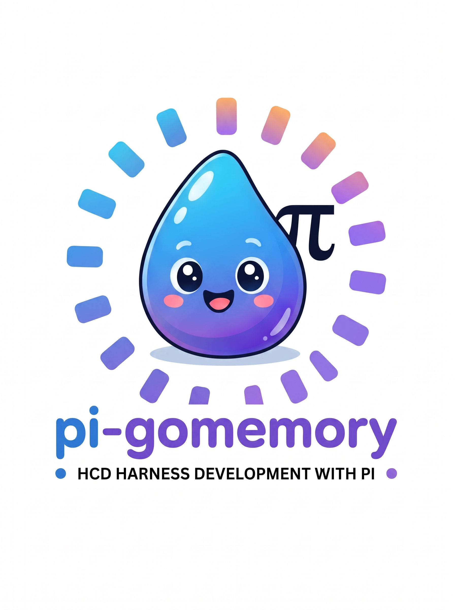

<p align="center">
  <picture>
    <source media="(prefers-color-scheme: dark)" srcset="assets/gomemory-readme-dark-pi.png">
    
  </picture>
</p>

<h3 align="center">Harness e instalador todo-en-uno para Pi Coding Agent en Herdr</h3>

<p align="center">
  <a href="https://github.com/Sayoner-000/pi-gomemory/releases/tag/v1.0.0"></a>
  <a href="https://golang.org"></a>
  <a href="LICENSE"></a>
  <a href="https://github.com/Sayoner-000/pi-gomemory"></a>
  <a href="https://github.com/Sayoner-000/gomemory"></a>
  <a href="https://github.com/Sayoner-000/pi-gomemory"></a>
</p>

---

Instalador y lanzador para Pi Coding Agent en Herdr. Empaqueta la configuración de [gomemory](https://github.com/Sayoner-000/gomemory), [CodeGraph](https://github.com/colbymchenry/codegraph), [codebase-memory-mcp](https://github.com/DeusData/codebase-memory-mcp), Google AI Pro y la interfaz TUI estilo Claude Code en un binario Go compilado con recursos embebidos mediante `embed.FS`.

Configura servidores MCP, temas de 24 bits, extensiones de terminal, filtros de cuotas de modelos y 21 skills oficiales sin requerir descargas adicionales en tiempo de ejecución.

```
$ pi-gomemory usage

Google AI Pro (g1-pro-tier)
Cuenta: sionernet@gmail.com

 Gemini Models
   [################----] Weekly Limit Remaining: 80.7% left · resets 3d 21h
   [################----] Five Hour Limit Remaining: 80.3% left · resets 4h 17m

 Claude and GPT models
   [####################] Weekly Limit Remaining: 100.0% left · resets 6d 22h
   [####################] Five Hour Limit Remaining: 100.0% left · resets 5h 0m

 Gemini 4 Argon
   [######--------------] Gemini 4 Argon Weekly Limit: 30.0% left · resets 5d 11h
```

## Inicio rápido

Instalación con una sola línea en macOS o Linux:

```bash
curl -fsSL https://raw.githubusercontent.com/Sayoner-000/pi-gomemory/main/install.sh | bash
```

O compilando desde el repositorio con Go 1.27+:

```bash
git clone https://github.com/Sayoner-000/pi-gomemory.git
cd pi-gomemory
make install
```

Para arrancar el agente Pi con el entorno y contexto configurados:

```bash
pi-gomemory
```

## Componentes incluidos

### Servidores MCP (`~/.pi/agent/mcp.json`)
* [gomemory](https://github.com/Sayoner-000/gomemory) (`mem mcp`): memoria persistente, sinapsis de proyecto, checkpoints y protocolo HCD (Harness Continual Development).
* [codegraph](https://github.com/colbymchenry/codegraph) (`codegraph serve --mcp`): grafo SQLite de AST para más de 30 lenguajes y exploración estructural.
* [codebase-memory](https://github.com/DeusData/codebase-memory-mcp) (`codebase-memory-mcp`): grafo de dependencias para análisis de impacto y trazado de llamadas.

El instalador añade estas entradas sin modificar servidores que ya tengas definidos.

### Modelos de Google AI Pro y Antigravity
Configura `npm:pi-antigravity` en `settings.json` y parchea la resolución de `peerDependencies` con `typebox: "*"` para evitar advertencias de npm.

El comando `pi-gomemory usage` consulta directamente el endpoint de Antigravity para mostrar cuotas semanales y de cinco horas con sus tiempos de reinicio.

### Interfaz TUI estilo Claude Code
* **pi-cc-extensions**: diffs visuales con formato de barras laterales e inspección de ventana de contexto con `/context`.
* **gomemory-status.ts**: barra inferior en la terminal con contadores de tokens (entrada, salida, caché) y coste acumulado, alternable con `/tokens`.
* **Tema gomemory**: paleta oficial en Truecolor de 24 bits (Abismo `#061328`, Brillo `#22e3f7`, Cian `#06c1ee`, Azur `#2c8ff0`, Índigo `#3926e3`, Violeta `#6b56d4`).

### 21 Skills sanitizadas
Copia y corrige el frontmatter YAML de las skills en `~/.pi/agent/skills/` para evitar errores de sintaxis en el motor de Pi:
* **HCD (Harness Continual Development)**: `hcd`, `hcd-define`, `hcd-clarify`, `hcd-approve`, `hcd-slice`, `hcd-tasks`, `hcd-implement`, `hcd-verify`, `hcd-analyze`, `hcd-close`.
* **Rigor**: `verify-loop`, `search-first`, `iterative-retrieval`, `strategic-compact`, `instincts`, `atomic-decomposition`.
* **Calidad**: `adversarial-consensus-review`, `defensive-qa-audit`.
* **Especializadas**: `codebase-memory`, `constitution`, `socratica`.

### Lanzador Herdr (`pi-gomemory`)
Script en `~/.local/bin/pi-gomemory` que asegura variables de entorno de terminal (`HERDR_ENV=1`, `COLORTERM=truecolor`). Si detecta una base de datos de gomemory en el directorio de trabajo (`.gomemory/memories.db`), ejecuta `mem context` e inyecta las memorias activas en Pi mediante `--append-system-prompt`.

## Comandos de la CLI

El binario `pi-gomemory-setup` permite ejecutar pasos independientes:

```bash
pi-gomemory-setup [install]   # Instalación completa de todos los módulos
pi-gomemory-setup usage       # Monitoreo de cuotas de Google AI Pro
pi-gomemory-setup doctor      # Diagnóstico de binarios, MCPs, tema y plugins
pi-gomemory-setup mcp         # Configuración exclusiva de mcp.json
pi-gomemory-setup theme       # Instalación exclusiva del tema visual
pi-gomemory-setup plugin      # Configuración de pi-antigravity y extensiones
pi-gomemory-setup skills      # Instalación y sanitización de skills
pi-gomemory-setup harness     # Generación del script lanzador pi-gomemory
```

## Empaquetado para distribución

Para compilar y empaquetar los binarios de release en las cuatro plataformas soportadas:

```bash
make dist
```

Genera los paquetes `.tar.gz` y el archivo `SHA256SUMS` en la carpeta `dist/` para `darwin/arm64`, `darwin/amd64`, `linux/amd64` y `linux/arm64`.

## Documentación técnica

En la carpeta [`docs/`](docs/) se detalla la arquitectura y el funcionamiento interno:

* [Índice de documentación](docs/index.md)
* [Arquitectura del sistema](docs/architecture.md)
* [Guía de instalación](docs/installation.md)
* [Guía de uso y comandos](docs/usage.md)

## Proyectos vinculados

pi-gomemory integra herramientas clave del ecosistema de desarrollo con agentes:

* [Sayoner-000/gomemory](https://github.com/Sayoner-000/gomemory): memoria colectiva persistente, sinapsis y protocolo de checkpoints y HCD.
* [colbymchenry/codegraph](https://github.com/colbymchenry/codegraph): inteligencia de código basada en grafos AST locales en SQLite para 30+ lenguajes.
* [DeusData/codebase-memory-mcp](https://github.com/DeusData/codebase-memory-mcp): grafo de conocimiento estructural y trazado de llamadas para bases de código complejas.

## Licencia

Distribuido bajo la licencia [MIT](LICENSE).
