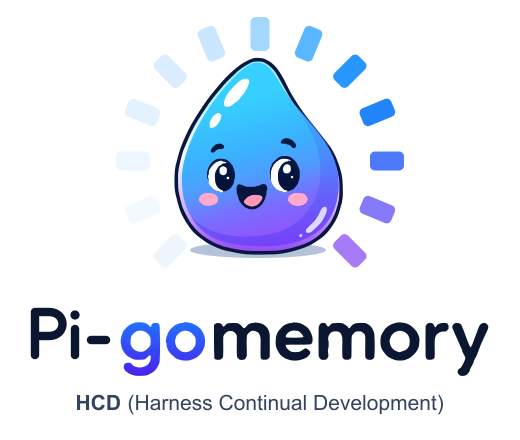
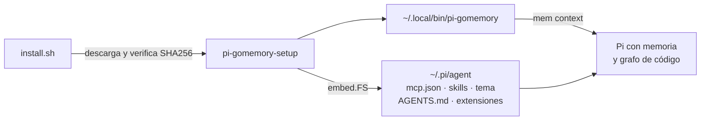

<p align="center">
  <picture>
    <source media="(prefers-color-scheme: dark)" srcset="assets/pi-gomemory-dark.svg">
    
  </picture>
</p>

<h3 align="center">Pi Coding Agent con memoria persistente y grafo de código, listo en un solo comando</h3>

<p align="center">
  <a href="https://github.com/Sayoner-000/pi-gomemory/releases/tag/v1.10.1"></a>
  <a href="https://golang.org"></a>
  <a href="LICENSE"></a>
  
  <a href="https://github.com/Sayoner-000/gomemory"></a>
</p>

<p align="center">
  <a href="#inicio-rápido">Inicio rápido</a> ·
  <a href="#qué-obtienes">Qué obtienes</a> ·
  <a href="#cómo-funciona">Cómo funciona</a> ·
  <a href="#otros-agentes">Otros agentes</a> ·
  <a href="docs/">Documentación</a>
</p>

---

Pi es un agente de código rápido y extensible, pero de serie empieza cada sesión sin recordar nada: no sabe qué decidiste ayer, qué bug ya corregiste ni cómo se relacionan los módulos de tu proyecto. Dejarlo a la altura de un entorno de trabajo serio implica registrar tres servidores MCP, copiar y corregir una veintena de skills, instalar plugins, ajustar el tema y escribir un launcher. Son tareas tediosas y fáciles de hacer a medias.

**pi-gomemory hace todo eso con un binario.** Los recursos (skills, tema, extensión y configuración) van embebidos en el ejecutable, así que la instalación no descarga nada en tiempo de ejecución y da el mismo resultado en cualquier máquina. Al terminar, Pi arranca con la memoria de [gomemory](https://github.com/Sayoner-000/gomemory), los grafos de [CodeGraph](https://github.com/colbymchenry/codegraph) y [codebase-memory-mcp](https://github.com/DeusData/codebase-memory-mcp), y el protocolo HCD (Harness Continual Development) cargado desde el primer mensaje.

## Inicio rápido

En macOS o Linux:

```bash
curl -fsSL https://raw.githubusercontent.com/Sayoner-000/pi-gomemory/main/install.sh | bash
```

El script descarga el binario de tu plataforma desde Releases, verifica su SHA256 contra `SHA256SUMS` y ejecuta la instalación. Después:

```bash
pi-gomemory
```

Si el directorio tiene una memoria de gomemory (`.gomemory/memories.db`), el launcher inyecta el contexto del proyecto en Pi antes de empezar.

<details>
<summary>Compilar desde el código fuente</summary>

Requiere Go 1.27 o superior.

```bash
git clone https://github.com/Sayoner-000/pi-gomemory.git
cd pi-gomemory
make install
```

</details>

## Qué obtienes

| Pieza | Qué hace en Pi | Dónde queda |
|---|---|---|
| **Memoria persistente** | `gomemory` guarda decisiones, bugs y convenciones y las devuelve en cada sesión | `~/.pi/agent/mcp.json` |
| **Grafo de código** | `codegraph` y `codebase-memory` responden quién llama a qué y qué rompe un cambio, sin recorrer archivos a ciegas | `~/.pi/agent/mcp.json` |
| **21 skills** | El ciclo HCD completo (`hcd`, `hcd-define` … `hcd-close`), verificación (`verify-loop`, `search-first`), revisión adversarial y auditoría defensiva | `~/.pi-gomemory/skills/` |
| **Protocolo de trabajo** | Instrucciones para que Pi consulte la memoria y el grafo antes de buscar con grep, y guarde lo que aprende | `~/.pi/agent/AGENTS.md` |
| **Modelos de Google AI Pro** | Plugin `pi-antigravity` y el comando `pi-gomemory usage`, que consulta la cuota real de tu cuenta | `~/.pi/agent/settings.json` |
| **Interfaz** | `pi-cc-extensions` (diffs laterales, `/context`), barra de tokens y coste (`/tokens`), y el tema gomemory en Truecolor | `~/.pi/agent/` |
| **Launcher** | `pi-gomemory` prepara el entorno de Herdr y carga el contexto del proyecto | `~/.local/bin/` |

`pi-gomemory-setup doctor` comprueba cada pieza y te dice qué falta.

Incluye `splash_review`, que ejecuta una revisión independiente con herramientas de
lectura y una definición neutral de Splash. Después de actualizar, usa `/reload`
en Pi para cargar la herramienta. Consulta [Splash](docs/SPLASH.md) para conocer
su aislamiento y compatibilidad con proveedores.

El diagnóstico también detecta las herramientas del portapapeles de macOS, X11 y
Wayland. En Linux y WSLg son dependencias del sistema y no van embebidas en el
binario; consulta [Portapapeles](docs/PORTAPAPELES.md).

## Cómo funciona



El instalador fusiona tu configuración en lugar de reemplazarla:

- En `mcp.json` solo cambia sus tres entradas. Tus otros servidores se conservan tal cual, con todos sus campos.
- En `pi-cc-extensions.json` solo añade las claves que no tengas. Lo que ya ajustaste se queda como está.
- En `AGENTS.md` el protocolo va entre `<!-- pi-gomemory:start -->` y `<!-- pi-gomemory:end -->`, así que el resto del archivo no se toca y reinstalar no duplica nada.
- Si un JSON existente es inválido, la instalación se detiene sin modificarlo.
- No escribe nada en el directorio desde el que lo ejecutas ni en la configuración de otros agentes.

## Otros agentes

pi-gomemory es específico de Pi. Si en Herdr también usas Claude Code, Codex, Antigravity (`agy`) u OpenCode, la memoria y los grafos llegan a ellos a través de gomemory, no de este instalador:

```bash
mem setup-mcp --scope global --agents claude,codex,agy,opencode
```

| | Pi | Claude Code | Codex | agy | OpenCode |
|---|:-:|:-:|:-:|:-:|:-:|
| MCP gomemory, codegraph, codebase-memory | pi-gomemory | gomemory | gomemory | gomemory | gomemory |
| Skills | pi-gomemory | gomemory | gomemory | gomemory¹ | gomemory |
| Tema, launcher y `usage` | pi-gomemory | no aplica | no aplica | no aplica | no aplica |

¹ En agy, las skills van a `~/.gemini/config/skills`. Hoy llegan 20 de las 21: falta `codebase-memory`.

`pi-gomemory-setup doctor` detecta qué agentes tienes instalados y te muestra el comando que corresponde a cada uno.

## Comandos

```text
pi-gomemory-setup [install]   Instalación completa
pi-gomemory-setup doctor      Diagnóstico de Pi, MCP, plugins, launcher y otros agentes
pi-gomemory-setup usage       Cuota real de Google AI Pro / Antigravity
pi-gomemory-setup mcp         Solo los servidores MCP
pi-gomemory-setup theme       Solo el tema
pi-gomemory-setup plugin      Solo pi-antigravity y pi-cc-extensions
pi-gomemory-setup skills      Reúne las skills de gomemory y del anfitrión en ~/.pi-gomemory/skills
pi-gomemory-setup skills-sync Sincroniza el repositorio central de skills y purga copias legadas
pi-gomemory-setup harness     Solo el launcher
pi-gomemory-setup version     Versión instalada
pi-gomemory-setup check-update  Avisa si hay una release nueva (caché de 24 h)
pi-gomemory-setup update      Descarga la última release, verifica SHA256SUMS y reinstala
pi-gomemory-setup deps-refresh  Consulta las últimas versiones de pi-gomemory y sus dependencias
pi-gomemory-setup deps-status   Componentes desactualizados según la última consulta (sale con 10)
pi-gomemory-setup deps-update   Actualiza los componentes desactualizados
pi-gomemory-setup claude-usage  Consumo de tokens de Claude Code en JSON (lo usa /sidebar)
pi-gomemory-setup uninstall [--dry-run] [--yes] [--verbose] [--packages] [--self]
                              Retira lo instalado por pi-gomemory; conserva la memoria de gomemory
```

Con `usage`, si la API no responde o el token caducó, el comando termina con un error. Nunca muestra cifras aproximadas. Las respuestas de más de 1 MiB se rechazan.

### Comandos dentro de Pi

| Comando | Qué hace |
|---|---|
| `/plan [petición]` | Modo plan: bloquea las modificaciones; `/plan` otra vez o `/plan run` lo desactivan |
| `/tasks` | Muestra u oculta las tareas de la unidad HCD activa |
| `/sidebar` | Panel lateral: sesión/HCD, contexto, coste, cuotas y servidores MCP |
| `/sidebar min` | Minimiza o restaura el panel lateral a una fila (también con clic en `[−]` / `[+]`) |
| `/min` | Minimiza o restaura a la vez `/sidebar` y `/tdd` |
| `/tdd` | TDD Live Inspector: ejecuta las pruebas reales del proyecto y muestra el recorrido en vivo |
| `/tdd run [suite]` | Ejecuta `all`, `backend`, `frontend`, `playwright`, `ci` o `data`; si hay otra ejecución en curso, queda en cola |
| `/tdd min` | Minimiza o restaura el inspector (también con clic en `[−]` / `[+]`) |
| `/tdd watch` | Ejecuta las pruebas tras cada turno; varios turnos seguidos se agrupan en una ejecución |
| `/tdd report` | Publica en el chat, y en el contexto del modelo, el informe de la última ejecución con cada fallo |
| `/tokens` | Muestra u oculta la barra de tokens y coste |

El agente dispone además de la tool `run_test_suite`, que devuelve cada fallo con mensaje, archivo:línea, paso, diagnóstico y sugerencia. Los paneles `/sidebar` y `/tdd` se apilan en la columna derecha sin solaparse; el clic funciona en el modo `fullscreen` de Pi (el predeterminado). Detalle en [docs/usage.md](docs/usage.md).

### Banner, modo /plan y repositorio de skills

- **Banner:** al abrir Pi, la cabecera muestra la gota de gomemory, «pi - gomemory», la versión de pi-gomemory (`PI_GOMEMORY_RUNNING_VERSION`) y la de gomemory instalada (`GOMEMORY_INSTALLED_VERSION`, leída de `mem --version`), ambas exportadas por el launcher. Con `NO_COLOR` se dibuja sin colores.
- **`/plan`:** activa el modo plan. Bloquea `edit`, `write` y los comandos de consola que modifican archivos (lista en `~/.pi/agent/extensions/gomemory-plan-patterns.json`), añade al contexto el método de `mem plan-context` y muestra «PLAN» en la barra. `/plan` otra vez o `/plan run` lo desactivan. Con `/plan <petición>` activa el modo y envía la petición en el mismo paso. Es un bloqueo de las modificaciones comunes, no un aislamiento completo.
- **Panel de tareas (`/tasks`):** encima del editor muestra las tareas de la unidad HCD activa, leídas de `mem hcd show --json`: `✓` verificada, `○` pendiente, `◌` verificación caducada, `✗` con fallo. Se actualiza al abrir la sesión, tras cada `mem hcd` y al terminar cada respuesta. `/tasks` lo muestra u oculta.
- **Repositorio de skills:** `~/.pi-gomemory/skills` reúne las 21 skills de gomemory (copias adaptadas para Pi, que siempre ganan) y enlaces a las skills de los demás agentes, en este orden de prioridad: `~/.agents/skills`, `~/.config/opencode/skills`, `~/.claude/skills`, `~/.codex/skills` y `~/.gemini/skills`. Pi carga solo ese repositorio, así que no hay avisos de colisión. Se sincroniza al instalar y en cada arranque de `pi-gomemory`. Nunca modifica las carpetas de otros agentes ni las skills tuyas.

### Actualizaciones del meta-harness

Cada vez que abres `pi-gomemory`, el launcher comprueba pi-gomemory, `pi`, `mem`, `codegraph`, `codebase-memory-mcp`, `pi-antigravity` y `pi-cc-extensions`. La consulta en red corre en segundo plano y no retrasa Pi; el aviso usa el resultado de la consulta anterior (`~/.pi/agent/pi-gomemory-deps.json`). Si hay algo desactualizado, lo lista con el comando de actualización y, en una terminal interactiva, pregunta `¿Actualizar ahora? [s/N]` durante 10 s. Sin respuesta, sigue sin actualizar. Para desactivarlo, define `PI_GOMEMORY_NO_UPDATE_CHECK=1`.

`pi-antigravity` y `pi-cc-extensions` se instalan fijados a la versión del catálogo oficial de Pi (`npm:pi-antigravity@0.12.0`, `npm:pi-cc-extensions@1.0.16`); cambian solo con una release nueva de pi-gomemory.

## Desarrollo

```bash
make build      # bin/pi-gomemory-setup
go test ./...   # pruebas del instalador en un HOME aislado
make dist       # tarballs para darwin/linux × amd64/arm64 y SHA256SUMS
```

`install.sh` acepta `PI_GOMEMORY_VERSION`, `PI_GOMEMORY_BIN_DIR` y `PI_GOMEMORY_BASE_URL`. Esta última permite probar el instalador contra un `dist/` local, por ejemplo `file://$PWD/dist`.

## Documentación

- [Arquitectura](docs/architecture.md): cómo se embeben y fusionan los recursos
- [Instalación](docs/installation.md): requisitos y opciones
- [Uso](docs/usage.md): comandos, cuotas y comandos dentro de Pi

## Proyectos relacionados

- [gomemory](https://github.com/Sayoner-000/gomemory): memoria colectiva para agentes, sinapsis entre memorias y protocolo HCD.
- [CodeGraph](https://github.com/colbymchenry/codegraph): grafo AST en SQLite para más de 30 lenguajes.
- [codebase-memory-mcp](https://github.com/DeusData/codebase-memory-mcp): grafo de conocimiento estructural y trazado de llamadas.

## Licencia

[MIT](LICENSE)
