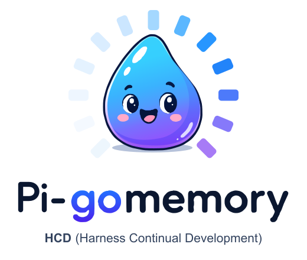
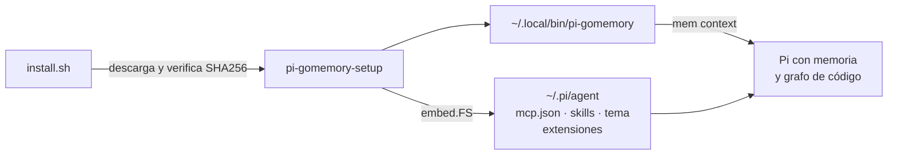

<p align="center">
  <picture>
    <source media="(prefers-color-scheme: dark)" srcset="assets/pi-gomemory-dark.svg">
    
  </picture>
</p>

<h3 align="center">Pi Coding Agent con memoria persistente y grafo de código, listo en un solo comando</h3>

<p align="center">
  <a href="https://github.com/Sayoner-000/pi-gomemory/releases/tag/v1.29.3"></a>
  <a href="https://golang.org"></a>
  <a href="LICENSE"></a>
  
  <a href="https://github.com/Sayoner-000/gomemory"></a>
</p>

<p align="center">
  <a href="#inicio-rápido">Inicio rápido</a> ·
  <a href="#qué-obtienes">Qué obtienes</a> ·
  <a href="#cómo-funciona">Cómo funciona</a> ·
  <a href="#otros-agentes">Otros agentes</a> ·
  <a href="docs/">Documentación</a>
</p>

---

pi-gomemory configura Pi Coding Agent con memoria persistente, grafos de código, skills de trabajo y extensiones de terminal. Registra los servidores MCP, instala los plugins fijados y prepara el launcher para Herdr.

Las skills, el tema y las extensiones van embebidos en el binario. Los paquetes npm y las consultas de versiones requieren red. Al iniciar una sesión, la extensión `gomemory-context.ts` carga las reglas y la memoria del proyecto con `mem context`; no depende de una copia del protocolo en `AGENTS.md`.

## Inicio rápido

En macOS o Linux:

```bash
curl -fsSL https://raw.githubusercontent.com/Sayoner-000/pi-gomemory/main/install.sh | bash
```

El script resuelve la última release, descarga el binario de tu plataforma, verifica su SHA256 contra `SHA256SUMS` y ejecuta la instalación. Para instalar una versión concreta, exporta antes `PI_GOMEMORY_VERSION=v1.29.3`.

El primer paso deja cada herramienta del meta-harness instalada y en su última versión. Si falta, la trae de su canal oficial; si está vieja, la actualiza con su propio comando, sin preguntar una por una:

| Herramienta | Canal oficial | Actualización | Si falla |
|---|---|---|---|
| `pi` | `https://pi.dev/install.sh` (antes comprueba Node.js 22.19+ y npm) | `pi update --self` | si no se puede instalar, se detiene la instalación |
| `mem` (gomemory) | `scripts/install.sh` de gomemory, con `GOMEMORY_BIN_DIR` = tu directorio de binarios | `mem update -y` | si no se puede instalar, se detiene la instalación |
| `codegraph` | `install.sh` de colbymchenry/codegraph | `codegraph upgrade` | avisa y sigue |
| `herdr` | `https://herdr.dev/install.sh`, con `HERDR_INSTALL_DIR` = tu directorio de binarios | `herdr update` | avisa y sigue |

Si lo ejecutas desde una terminal, antes de empezar ves la lista con la versión instalada y la publicada de cada una. Escribe los números de las opcionales que no quieras y pulsa Enter; `pi` y `mem` no se pueden desmarcar. Sin terminal, o si solo pulsas Enter, se tratan todas.

Si falta Node.js 22.19 o npm, la instalación se detiene antes de lanzar el instalador de Pi y te dice cómo instalarlos. Los scripts se ejecutan con la entrada en `/dev/null` y un límite de 10 minutos. Los instaladores oficiales pueden añadir su directorio al `PATH` en `~/.zshrc` o `~/.bashrc`. Para omitir este paso define `PI_GOMEMORY_SKIP_DEPS=1` (vacía, `0` o `false` lo dejan activo); con el modo lite las opcionales salen desmarcadas. `uninstall` conserva estas herramientas y te dice cómo quitar cada una.

Después:

```bash
pi-gomemory
```

Si el directorio tiene una memoria de gomemory (`.gomemory/memories.db`), el launcher inyecta el contexto del proyecto en Pi antes de empezar.

<details>
<summary>Compilar desde el código fuente</summary>

Requiere Go 1.27 o superior.

```bash
git clone https://github.com/Sayoner-000/pi-gomemory.git
cd pi-gomemory
make install
```

</details>

## Qué obtienes

| Pieza | Qué hace en Pi | Dónde queda |
|---|---|---|
| **Memoria persistente** | `gomemory` guarda decisiones, bugs y convenciones y las devuelve en cada sesión | `~/.pi/agent/mcp.json` |
| **Grafo de código** | `codegraph` responde quién llama a qué y qué rompe un cambio, sin recorrer archivos a ciegas | `~/.pi/agent/mcp.json` |
| **20 skills** | El ciclo HCD completo (`hcd`, `hcd-define` … `hcd-close`), verificación (`verify-loop`, `search-first`), revisión adversarial y auditoría defensiva | `~/.pi-gomemory/skills/` |
| **Contexto y protocolo** | Carga `mem context` por sesión y exige medir impacto con `codegraph` antes de editar o abrir un HCD | `~/.pi/agent/extensions/gomemory-context.ts` |
| **Modelos de Google AI Pro** | Plugin `pi-antigravity` y el comando `pi-gomemory usage`, que consulta la cuota real de tu cuenta | `~/.pi/agent/settings.json` |
| **Interfaz** | `pi-cc-extensions` (diffs laterales, `/context`), thinking colapsado por defecto (`Ctrl+T`) con indicador animado y etiqueta `(thinking...)`, barra de tokens y coste (`/tokens`), paneles `/tasks` y `/tdd`, sugerencia en el input (`Tab`) y el tema gomemory en Truecolor | `~/.pi/agent/` |
| **Launcher** | `pi-gomemory` prepara el entorno de Herdr y carga el contexto del proyecto | `~/.local/bin/` |

`pi-gomemory-setup doctor` comprueba cada pieza y te dice qué falta.

Incluye `splash_review`, que ejecuta una revisión independiente con herramientas de
lectura y una definición neutral de Splash. Después de actualizar, usa `/reload`
en Pi para cargar la herramienta. Consulta [Splash](docs/SPLASH.md) para conocer
su aislamiento y compatibilidad con proveedores.

El diagnóstico también detecta las herramientas del portapapeles de macOS, X11 y
Wayland. En Linux y WSLg son dependencias del sistema y no van embebidas en el
binario; consulta [Portapapeles](docs/PORTAPAPELES.md).

## Cómo funciona



El instalador fusiona tu configuración en lugar de reemplazarla:

- En `mcp.json` solo cambia sus dos entradas (`gomemory` y `codegraph`) y retira la entrada heredada de `codebase-memory` si fue gestionada por pi-gomemory. Tus otros servidores se conservan tal cual, con todos sus campos.
- En `pi-cc-extensions.json` conserva tus claves; `showStartupHeader` se desactiva para evitar que tape el banner de gomemory.
- En `AGENTS.md` retira el bloque heredado de pi-gomemory, después de instalar la extensión que lo sustituye, y conserva tu texto, permisos y enlaces. Si solo había protocolo, elimina el archivo normal o vacía el destino del enlace. Si los marcadores de pi-gomemory son ambiguos, conserva el archivo completo y avisa.
- Si un JSON existente es inválido, la instalación se detiene sin modificarlo.
- No escribe nada en el directorio desde el que lo ejecutas ni en la configuración de otros agentes.

## Otros agentes

pi-gomemory es específico de Pi. Si en Herdr también usas Claude Code, Codex, Antigravity (`agy`) u OpenCode, la memoria y los grafos llegan a ellos a través de gomemory, no de este instalador:

```bash
mem setup-mcp --scope global --agents claude,codex,agy,opencode
```

| | Pi | Claude Code | Codex | agy | OpenCode |
|---|:-:|:-:|:-:|:-:|:-:|
| MCP gomemory y codegraph | pi-gomemory | gomemory | gomemory | gomemory | gomemory |
| Skills | pi-gomemory | gomemory | gomemory | gomemory | gomemory |
| Tema, launcher y `usage` | pi-gomemory | no aplica | no aplica | no aplica | no aplica |

`pi-gomemory-setup doctor` detecta qué agentes tienes instalados y te muestra el comando que corresponde a cada uno.

## Comandos

```text
pi-gomemory-setup [install]   Instalación completa
pi-gomemory-setup doctor      Diagnóstico de Pi, MCP, plugins, launcher y otros agentes
pi-gomemory-setup usage       Cuota real de Google AI Pro / Antigravity
pi-gomemory-setup mcp         Solo los servidores MCP
pi-gomemory-setup codemode <on|off|status>  Activa o desactiva el modo codemode híbrido en Pi y MCP
pi-gomemory-setup theme       Solo el tema
pi-gomemory-setup plugin      Solo pi-antigravity y pi-cc-extensions
pi-gomemory-setup skills      Reúne las skills de gomemory y del anfitrión en ~/.pi-gomemory/skills
pi-gomemory-setup skills-sync Sincroniza el repositorio central de skills y purga copias legadas
pi-gomemory-setup skills-sync --check  Solo comprueba; sale con 10 si hay skills desfasadas o editadas que difieren de mem
pi-gomemory-setup skills-sync --restore <skill>…  Repone skills de gomemory editadas localmente
pi-gomemory-setup harness     Solo el launcher
pi-gomemory-setup version     Versión instalada
pi-gomemory-setup check-update  Avisa si hay una release nueva (caché de 24 h)
pi-gomemory-setup update      Descarga la última release, verifica SHA256SUMS y reinstala; después ejecuta sync
pi-gomemory-setup sync [--yes] [--json] [--only=a,b | --skip=c]
                              Instala lo que falta y actualiza lo desactualizado de pi, mem, codegraph y herdr
pi-gomemory-setup components --names | --json  Lista los componentes del meta-harness y su estado
pi-gomemory-setup deps-refresh  Consulta las últimas versiones de pi-gomemory y sus dependencias
pi-gomemory-setup deps-status   Componentes desactualizados según la última consulta (sale con 10)
pi-gomemory-setup deps-update   Actualiza los componentes desactualizados
pi-gomemory-setup claude-usage  Consumo de tokens de Claude Code en JSON (lo usa /sidebar)
pi-gomemory-setup anthropic-usage  Límites del plan de Anthropic (sesión de 5 h y semana) en JSON (lo usa /sidebar)
pi-gomemory-setup codex-usage      Límites del plan de OpenAI Codex (ventanas primaria y secundaria) en JSON
pi-gomemory-setup uninstall [--dry-run] [--yes] [--verbose] [--packages] [--self]
                              Retira lo instalado por pi-gomemory; conserva la memoria de gomemory
```

Con `usage`, si la API no responde o el token caducó, el comando termina con un error. Nunca muestra cifras aproximadas. Las respuestas de más de 1 MiB se rechazan.

### Codemode y contexto por sesión

Desde v1.24.0, `install` y `update` dejan Pi en modo **codemode híbrido**. El modelo recibe directas solo las tools que usa a diario (contexto y memoria de gomemory y `codegraph_explore`) y llega al resto desde `codemode`. Si prefieres todas directas:

```bash
pi-gomemory-setup codemode off
pi-gomemory-setup codemode status
```

La elección queda en `~/.pi-gomemory/codemode.json` y se respeta al reinstalar o actualizar. `codemode on` vuelve al híbrido. En modo híbrido se conservan herramientas MCP de consulta frecuente como directas y las demás siguen disponibles desde `codemode` mediante `tools.<nombre>(args)`. CodeGraph permanece siempre directo.

Si `codemode status` responde `parcial`, Pi tiene `+codemode` activo pero los servidores siguen en directo (o al revés) y carga las dos cosas a la vez. Elige un modo con `codemode on` u `codemode off`.

La extensión de contexto ejecuta `mem context` una vez por sesión con un timeout de tres segundos. Conserva hasta 24 576 bytes de texto UTF-8 y añade un aviso si lo recorta. Si la consulta falla, muestra una advertencia y carga solo el bloque específico de Pi. `/plan` añade su método en una sección separada del prompt.

`uninstall` reconoce los perfiles MCP directo e híbrido intactos y retira `+codemode` solo cuando hay constancia de que lo añadió pi-gomemory. Consulta los [límites conocidos](docs/known-issues.md) antes de automatizar cambios de configuración.

### Comandos dentro de Pi

| Comando | Qué hace |
|---|---|
| `/plan [petición]` | Sin argumentos alterna el modo plan; con una petición lo activa y envía el texto |
| `/plan on`, `/plan off`, `/plan status` | Activa, desactiva o consulta el modo plan sin iniciar un turno |
| `/plan run` | Desactiva el modo plan; no ejecuta el plan automáticamente |
| `Alt+P` (respaldo `Ctrl+Alt+P`) | Activa o desactiva el modo plan sin iniciar un turno. En Windows y WSL solo `Ctrl+Alt+P` |
| `/tasks` | Muestra u oculta las tareas HCD y su árbol de actividad |
| `/tasks expand [N]`, `/tasks collapse [N]`, `/tasks focus N` | Abre o cierra el detalle y elige la tarea que recibe las próximas llamadas |
| `/sidebar` | Panel lateral: sesión/HCD, contexto, coste, cuotas (Google AI Pro, límites de Anthropic y OpenAI Codex) y servidores MCP |
| `/sidebar min` | Minimiza o restaura el panel lateral a una fila (también con clic en `[−]` / `[+]`) |
| `/min` | Minimiza o restaura a la vez `/sidebar` y `/tdd` |
| `/tdd` | TDD Live Inspector: ejecuta las pruebas reales del proyecto y muestra el recorrido en vivo |
| `/tdd run [suite]` | Ejecuta `all`, `backend`, `frontend`, `playwright`, `ci` o `data`; si hay otra ejecución en curso, queda en cola |
| `/tdd min` | Minimiza o restaura el inspector (también con clic en `[−]` / `[+]`) |
| `/tdd watch` | Ejecuta las pruebas una vez cuando el agente termina, solo si cambió archivos (`edit`, `write` o `bash`); no bloquea al agente |
| `/tdd report` | Publica en el chat, y en el contexto del modelo, el informe de la última ejecución con cada fallo |
| `/tokens` | Muestra u oculta la barra de tokens y coste; el aviso de actualizaciones pasa al pie por defecto de Pi |
| `/componentes` | Lista los componentes del meta-harness con su versión instalada y la publicada, y reconcilia los que marques |

El agente dispone además de la tool `run_test_suite`, que devuelve cada fallo con mensaje, archivo:línea, paso, diagnóstico y sugerencia. Los paneles `/sidebar` y `/tdd` se apilan en la columna derecha sin solaparse; el clic funciona en el modo `fullscreen` de Pi (el predeterminado). Detalle en [docs/usage.md](docs/usage.md).

### Banner, modo /plan y repositorio de skills

- **Banner:** al abrir Pi, la cabecera muestra el logo de pi-gomemory en caracteres de color de alta resolución, «HCD · pi - gomemory», la versión de pi-gomemory (`PI_GOMEMORY_RUNNING_VERSION`) y la de gomemory instalada (`GOMEMORY_INSTALLED_VERSION`, leída de `mem --version`), junto con el lema HCD. Con `NO_COLOR` se dibuja sin colores.
- **`/plan`:** activa el modo plan. Bloquea `edit`, `write` y los comandos de consola que modifican archivos (lista en `~/.pi/agent/extensions/gomemory-plan-patterns.json`), añade al contexto el método de `mem plan-context` y muestra «PLAN» en la barra. Usa `/plan on` para activarlo, `/plan off` para salir y `/plan status` para consultar el estado. `/plan` sin argumentos lo alterna y `/plan run` sigue desactivándolo sin ejecutar el plan. Con `/plan <petición>` activa el modo y envía la petición en el mismo paso. `Alt+P` lo alterna desde el teclado (`Ctrl+Alt+P` si la terminal de macOS no envía Option como Alt; en Windows y WSL solo `Ctrl+Alt+P`, porque Pi usa allí `Alt+P`). La cabecera muestra el estado: `◆ MODO PLAN ON · Alt+P` en ámbar o `○ plan off · Alt+P` atenuado. Es un bloqueo de las modificaciones comunes, no un aislamiento completo.
- **Panel de tareas (`/tasks`):** encima del editor muestra las tareas de la unidad HCD activa, leídas de `mem hcd show --json`: `○` pendiente, `●`/`○` parpadeando en curso, `●` verificada (atenuado si caducó durante `implement`, que gomemory ≥ 2.59.0 cuenta como progreso), `↻` verificación caducada que hay que revalidar en `verify`, `✗` con fallo. La cabecera lleva una barra continua `━━━───` con el avance. El árbol de actividad muestra el estado y la duración de las llamadas de esta sesión. En `/tdd`, las verificaciones Bash tienen sus propias filas y Watch no las borra.
- **Repositorio de skills:** `~/.pi-gomemory/skills` reúne las 20 skills de gomemory (copias adaptadas para Pi, que siempre ganan) y enlaces a las skills de los demás agentes, en este orden de prioridad: `~/.agents/skills`, `~/.config/opencode/skills`, `~/.claude/skills`, `~/.codex/skills` y `~/.gemini/skills`. Pi carga solo ese repositorio, así que no hay avisos de colisión. Se sincroniza al instalar y en cada arranque de `pi-gomemory`. Nunca modifica las carpetas de otros agentes ni las skills tuyas. Si `mem update` trae skills nuevas, Pi lo detecta al iniciar la sesión o justo después de un `mem update` lanzado desde Pi (`pi-gomemory-setup skills-sync --check`), sincroniza y avisa de que `/reload` las carga. Las copias de gomemory que se editaron a mano no se sobrescriben: Pi avisa en amarillo de las que quedaron desfasadas y `pi-gomemory-setup skills-sync --restore <skill>` las repone.

### Actualizaciones del meta-harness

Cada vez que abres `pi-gomemory`, el launcher comprueba pi-gomemory, `pi`, `mem`, `codegraph`, `herdr`, `pi-antigravity` y `pi-cc-extensions`. La consulta en red corre en segundo plano y no retrasa Pi; el aviso usa la última publicada según la consulta anterior (`~/.pi/agent/pi-gomemory-deps.json`) y, desde v1.13.0, compara con la versión que tienes instalada ahora, así que no anuncia algo que ya actualizaste por otra vía. Si hay algo desactualizado, lo lista con el comando de actualización y, en una terminal interactiva, pregunta `¿Actualizar ahora? [s/N]` durante 10 s. Sin respuesta, sigue sin actualizar.

Dentro de Pi, el pie muestra **`↑ actualizaciones disponibles`** en su extremo derecho mientras haya algo desactualizado. Al abrir la sesión consulta el estado, refresca en segundo plano si la última consulta en red tiene más de una hora y vuelve a consultar, de modo que una release se anuncia como mucho una hora después de publicarse. El aviso solo informa: para instalar, responde a la pregunta del launcher, ejecuta `pi-gomemory-setup deps-update` o usa `/componentes` sin salir de Pi. Si se actualizó `pi`, `/componentes` te pide reiniciar Pi. Para desactivar el aviso y la pregunta, define `PI_GOMEMORY_NO_UPDATE_CHECK=1`. Vacía, `0` o `false` la dejan activa. `sync`, `update` y `/componentes` consultan igualmente, porque los pides tú.

`pi-gomemory-setup sync` es la forma directa de dejar las herramientas al día. `update` lo ejecuta al terminar, y `deps-update` le pasa las herramientas desactualizadas en una sola llamada, así que ninguna se actualiza dos veces.

`pi-antigravity` y `pi-cc-extensions` se instalan fijados a una versión exacta (`npm:pi-antigravity@0.15.0`, `npm:pi-cc-extensions@1.0.22`); cambian solo con una release nueva de pi-gomemory, que antes valida cada versión candidata contra lo que pi-gomemory necesita de ella. Si npm publica una versión más nueva que todavía no se ha validado, `pi-gomemory-setup doctor` lo avisa con `⚠`, pero `deps-update` sigue instalando solo la versión fijada.

### Cuota de OpenAI Codex

Desde v1.12.0, con el proveedor `openai-codex` activo, `/sidebar` muestra «▼ Codex Quota»: porcentaje **restante**, barras y tiempo hasta el reinicio de las ventanas primaria y secundaria. El comando `pi-gomemory-setup codex-usage` devuelve porcentaje **usado** en JSON. Ambos usan la sesión OAuth de Pi; no consultan la caché de la aplicación Codex ni renuevan tokens.

## Limitaciones conocidas

**Antigravity y HTTP 429:** una sesión OAuth válida y cuota disponible no garantizan que Google acepte la petición de generación. v1.15.3 publica una regresión y una [mitigación local opcional](docs/antigravity.md) para el patrón reproducido con las instrucciones de Pi. El guard conserva el texto, pero reduce su prioridad al moverlo a un mensaje de usuario. No se instala por defecto; actualizar pi-gomemory no activa la mitigación.

Desde v1.12.1 están corregidos los seis hallazgos de [HCD-027](hcd/HCD-027-cierre-de-los-seis-defectos-reproducidos.md) (permisos de configuración MCP, limpieza de skills legacy y resultados/terminación TDD), así como el bucle de `/tdd watch`. v1.13.0 corrige que `uninstall` con otro `HOME` borrara el launcher de la instalación real ([HCD-030](hcd/HCD-030-uninstall-no-debe-tocar-un-launcher-fuer.md)). `install`, `update` y `uninstall` conservan los permisos que tenga `~/.pi/agent/AGENTS.md` ([HCD-032](hcd/HCD-032-install-y-uninstall-conservan-los-permis.md)). v1.13.4 hace que `uninstall` conserve lo que cambió después del plan y falle si no pudo leer algo, y que `update` rechace un ejecutable incompleto ([HCD-034](hcd/HCD-034-uninstall-y-update-no-pierden-datos-ni-a.md)). v1.13.5 conserva el manifiesto si `uninstall` falla, mata los procesos de prueba que ignoran SIGTERM al cancelar `/tdd` y hace que `update` reinstale en el `BIN_DIR` de la instalación y consulte siempre ([HCD-035](hcd/HCD-035-cerrar-h-01-a-h-05-de-la-auditoria-acr-a.md)). v1.13.6 conserva los enlaces simbólicos de `mcp.json`, `settings.json`, `AGENTS.md` y `pi-cc-extensions.json`: escribe en el archivo de destino y rechaza los enlaces rotos sin tocar nada ([HCD-036](hcd/HCD-036-las-configuraciones-de-pi-enlazadas-con.md)). Los límites vigentes están en [problemas conocidos](docs/known-issues.md).

## Desarrollo

```bash
make build      # bin/pi-gomemory-setup
go test ./...   # pruebas del instalador en un HOME aislado
make dist       # tarballs para darwin/linux × amd64/arm64 y SHA256SUMS
```

La suite de Go también ejecuta las 22 pruebas offline del guard mediante Node.js; requiere `node` en el PATH y falla si falta. No accede a credenciales ni a Google. Puedes ejecutarlas por separado con `node --test tests/antigravity-prompt-guard/guard.test.mjs`.

`install.sh` acepta `PI_GOMEMORY_VERSION`, `PI_GOMEMORY_BIN_DIR`, `PI_GOMEMORY_BASE_URL`, `PI_GOMEMORY_LATEST_URL` y `PI_GOMEMORY_SKIP_DEPS`. Sin `PI_GOMEMORY_VERSION` lee la etiqueta de la redirección de `PI_GOMEMORY_LATEST_URL` (por defecto, `releases/latest` del repositorio); si no la obtiene, se detiene y sugiere fijar la versión. `PI_GOMEMORY_BASE_URL` permite probar el instalador contra un `dist/` local, por ejemplo `file://$PWD/dist`. Al compilar desde el código fuente no consulta la red. `bash scripts/clean-install-check.sh` ejecuta la instalación completa en un HOME temporal con compilación local y comprueba que `pi`, `mem`, `codegraph` y `herdr` respondan (requiere red).

## Documentación

- [Guía HTML v1.15](docs/Guia-PI-GOMEMORY-v1.15.html): instalación, contexto por sesión y referencia de comandos
- [Notas de v1.26.1](docs/releases/v1.26.1.md): `pi-cc-extensions` fijado en 1.0.22 (HCD-078)
- [Notas de v1.26.0](docs/releases/v1.26.0.md): catálogo único de componentes, `sync`, herdr opcional, selector en la terminal, `/componentes` en Pi e `install.sh` sobre la última release (HCD-076)
- [Notas de v1.25.1](docs/releases/v1.25.1.md): correcciones del ACR de v1.25.0 en launcher, doctor, caché de dependencias y modo plan (HCD-075)
- [Notas de v1.25.0](docs/releases/v1.25.0.md): sincronización de skills desde `mem`, aviso de desfase en `doctor` y `codegraph` como grafo principal (HCD-073)
- [Notas de v1.24.1](docs/releases/v1.24.1.md): actualización de las skills embebidas `hcd-implement` y `hcd-verify` para evitar revalidaciones innecesarias (HCD-072)
- [Notas de v1.24.0](docs/releases/v1.24.0.md): `install` y `update` dejan Pi en codemode híbrido por defecto (HCD-071)
- [Notas de v1.15.4](docs/releases/v1.15.4.md): modo MCP directo (`codemode off`) por defecto y transición limpia desde v1.15.x (HCD-050)
- [Notas de v1.15.3](docs/releases/v1.15.3.md): regresión de Antigravity, cierre verificado de HCD-040 y mitigación local opt-in
- [Antigravity: HTTP 429 y mitigación local](docs/antigravity.md): diagnóstico, riesgo de prioridad, activación manual y reversión
- [Notas de v1.15.2](docs/releases/v1.15.2.md): cierre de cinco hallazgos ACR/ADM de v1.15.1 (HCD-048)
- [Notas de v1.15.1](docs/releases/v1.15.1.md): corrección de los ocho hallazgos del ACR de v1.15.0
- [Notas de v1.15.0](docs/releases/v1.15.0.md): contexto vivo, codemode por defecto y migración del protocolo
- [Notas de v1.14.0](docs/releases/v1.14.0.md): modo `codemode` híbrido (`on`/`off`/`status`), validación y subida de pins de Pi (`pi-antigravity@0.14.0`, `pi-cc-extensions@1.0.21`), y cierre de los hallazgos ACR/ADM H-02..H-05 y F-01..F-02
- [Notas de v1.13.8](docs/releases/v1.13.8.md): `/tdd` falla en lugar de acumular sin límite una línea de salida enorme, y la cuota de Antigravity ya no da por buena una respuesta vacía ni le atribuye un plan
- [Notas de v1.13.7](docs/releases/v1.13.7.md): `PI_GOMEMORY_NO_UPDATE_CHECK` se interpreta igual en el binario, el launcher y el pie de Pi, y `deps-refresh` la respeta
- [Notas de v1.13.6](docs/releases/v1.13.6.md): la configuración de Pi enlazada con symlinks (por ejemplo, desde dotfiles) sigue enlazada tras `install`, `update` y `uninstall`; los enlaces rotos se rechazan sin tocar nada
- [Notas de v1.13.5](docs/releases/v1.13.5.md): `uninstall` conserva el manifiesto si algo falla; cancelar `/tdd` no deja procesos vivos; `update` reinstala en el `BIN_DIR` de la instalación y consulta siempre
- [Notas de v1.13.4](docs/releases/v1.13.4.md): `uninstall` no borra lo que cambió después del plan ni anuncia éxito si no pudo leer algo; `update` rechaza ejecutables incompletos
- [Notas de v1.13.3](docs/releases/v1.13.3.md): timeout propio en las consultas de versiones y `-race` al empaquetar
- [Notas de v1.13.2](docs/releases/v1.13.2.md): `install`, `update` y `uninstall` conservan los permisos de `AGENTS.md`
- [Notas de v1.13.1](docs/releases/v1.13.1.md): las releases nuevas se anuncian como mucho una hora después de publicarse
- [Notas de v1.13.0](docs/releases/v1.13.0.md): aviso de actualizaciones fiable y en el pie de Pi; `uninstall` acotado a su HOME
- [Notas de v1.12.1](docs/releases/v1.12.1.md): correcciones de HCD-027 y del modo watch
- [Notas de v1.12.0](docs/releases/v1.12.0.md): cuota de OpenAI Codex
- [Arquitectura](docs/architecture.md): cómo se embeben y fusionan los recursos
- [Instalación](docs/installation.md): requisitos y opciones
- [Uso](docs/usage.md): comandos, cuotas y comandos dentro de Pi

## Proyectos relacionados

- [gomemory](https://github.com/Sayoner-000/gomemory): memoria colectiva para agentes, sinapsis entre memorias y protocolo HCD.
- [CodeGraph](https://github.com/colbymchenry/codegraph): grafo AST en SQLite para más de 30 lenguajes.

## Licencia

[MIT](LICENSE)
